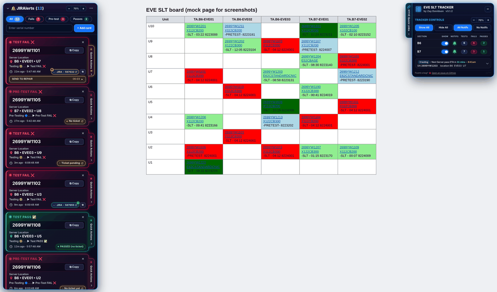
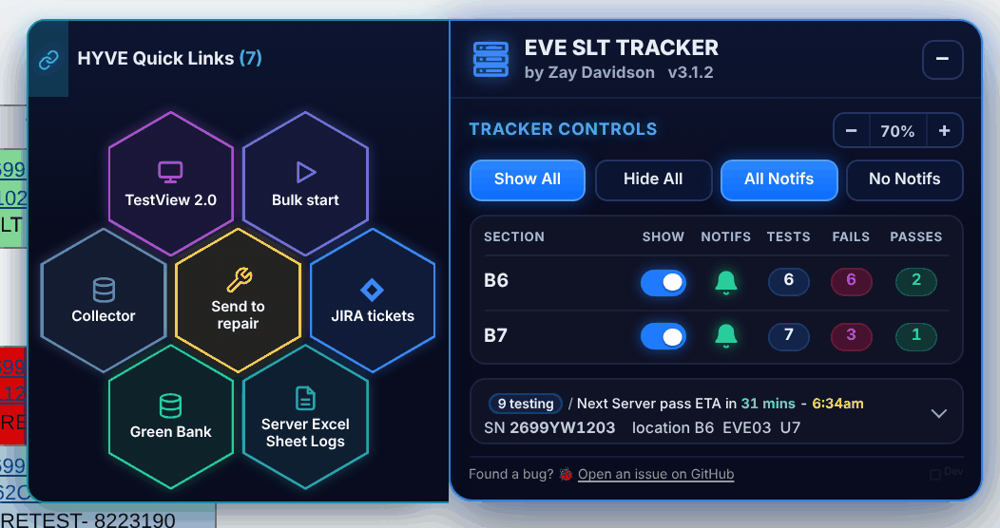
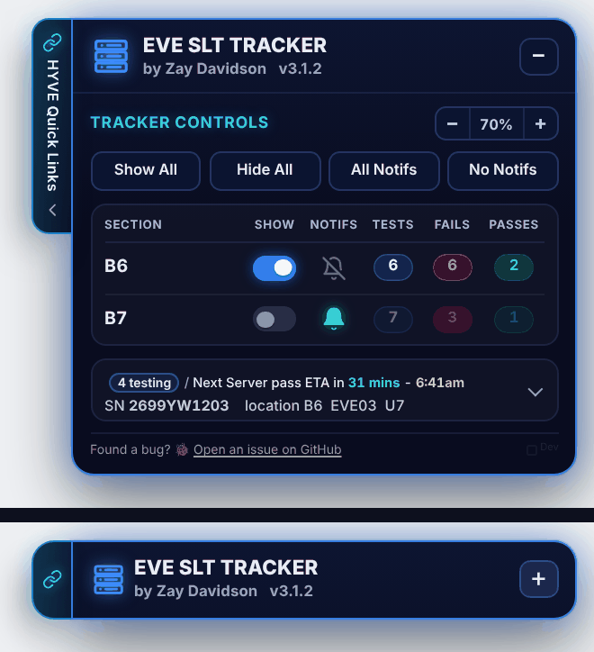
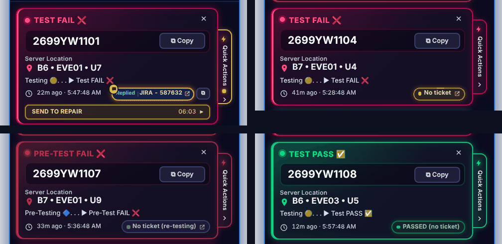
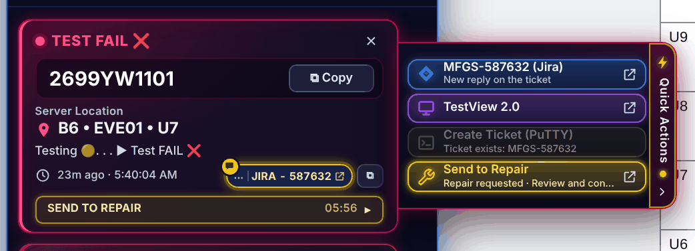
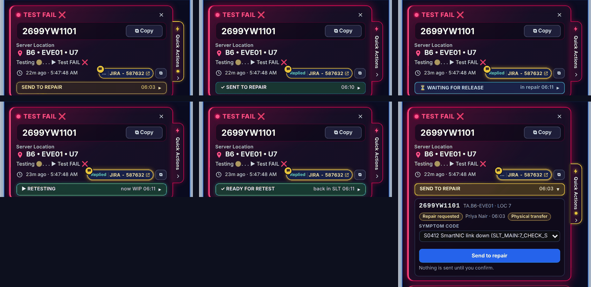
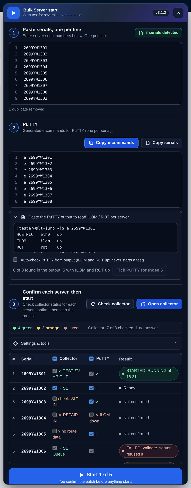

# EVE SLT TRACKER

**Version 3.1.2** · A Tampermonkey userscript that watches the EVE SLT racks and tells you the moment a server fails, passes or needs repair.

*Mock board for screenshots. Left: JIRAlerts. Right: the tracker.*

---

## Install in 3 steps

1. Install [Tampermonkey](https://www.tampermonkey.net/) (Edge, Chrome or Firefox).
2. Open the **[install link](https://raw.githubusercontent.com/zayd117/EVE-SLT-TRACKER/main/EVE_SLT_TRACKER.user.js)** and click **Install** (or **Update**).
3. Reload the rack page and allow the Jira, TestView and SFCS connections when asked.

**Good to know**

- Keep only one copy enabled. Disable the old "EVE SLT+JBOG TRACKER" in the Tampermonkey Dashboard.
- Your saved settings carry over.
- If the link shows code instead of an installer: Tampermonkey Dashboard, **Utilities**, **Import from URL**.

---

## What it does

| You want to... | It gives you... |
|---|---|
| Know when a server fails or passes | An alert card and a desktop notification |
| Find the Jira ticket | A button on the card with the ticket and its status |
| Send a unit to repair | A **Send to repair** box on the card that fills in SFCS for you |
| Know if repair released it | A live status bar that follows the Collector |
| Jump to your tools | HYVE Quick Links and a **Quick Actions** tray |
| Start many pre-tests | **Bulk start** on the TestView operator page |

---

## Tracker panel

- **Show** switch: show or hide a rack row on the board.
- **Notifs** bell: green means notifications on, grey with a slash means off.
- **Show All / Hide All / All Notifs / No Notifs**: change every row at once.
- **Running ETA**: how many servers are testing and when the next one should pass.
- **- 70% +**: make the panel smaller or larger (50 to 100%).
- **Minus button**: fold the panel to a slim bar.

---

## Alert cards (JIRAlerts)

Each card shows:

- the **serial** (click it to copy)
- the **rack location**
- the **phase** (Test or Pre-test, fail or pass)
- **how long ago** it happened
- the **Jira button** (ticket number, or "No ticket" / "Ticket pending")

Card colors:

- **Red**: test fail
- **Dark red**: pre-test fail
- **Green**: pass

Panel tools:

- **Filters**: All, Fails, Pre-test, Passes.
- **Add card**: type a serial to track it.
- **Menu**: export the shift log, or dismiss all cards (click twice to confirm).

---

## Quick Actions

Open the **Quick Actions** tab on the right edge of a card.

- **Jira ticket** (MFGS-number): open it.
- **TestView 2.0**: open the unit's test page.
- **Create ticket** (PuTTY): copies the ticket command for this serial. Greyed out when a ticket already exists.
- **Send to repair**: opens the repair box.

Press **Esc** to close it.

---

## Send to repair

The bar at the bottom of a card tells you where the unit is:

| Bar | Meaning | What you do |
|---|---|---|
| **SEND TO REPAIR** | Repair asked for it in the Jira comment | Open the card and send it |
| **SENT TO REPAIR** | SFCS accepted it | Wait, or take it to repair if asked |
| **WAITING FOR RELEASE** | Collector shows it in the repair queue | Nothing |
| **RETESTING** | Collector shows it testing again | Nothing |
| **READY FOR RETEST** | Collector shows it back in the SLT queue | Start the retest |

Steps:

1. Click the bar to open the box.
2. Check the serial and the symptom code (it is pre-selected from the Jira title).
3. Click **Send to repair**, then **Confirm**. Nothing is sent before Confirm.

Things to know:

- The bar updates by itself. You do not need to open the card.
- A unit that is already sent cannot be sent again.
- If you are not signed in to SFCS, the box tells you and offers **Open SFCS**.

---

## HYVE Quick Links

- Seven links in one drawer: TestView 2.0, Bulk start, Collector, Send to repair, JIRA tickets, Green Bank, Server Excel Sheet Logs.
- Click the **HYVE Quick Links** tab to open or close it.
- The **minus** button also closes it when it folds the tracker. Unfolding never opens it.

---

## Bulk start

On the TestView operator page, click **Bulk Server start**.

1. Paste the serials, one per line.
2. Copy the PuTTY commands and paste the output back to tick ILOM and ROT.
3. Click **Check collector**. Green is ready, orange needs a look, red is not ready.
4. Click **Start**. You confirm the batch before anything starts.

---

## Developer mode

Flip the **Dev** switch at the bottom of the tracker for diagnostics, the refresh countdown, test buttons and the Collector evidence behind each repair bar. Normal view stays simple.

---

## Troubleshooting

| Problem | Fix |
|---|---|
| No cards | Check the **Show** switch for that rack row |
| Cards but no desktop notification | Check the **Notifs** bell, the browser's notification permission and Windows Do not disturb |
| Jira button says login needed | Log in to Jira in the same browser |
| Repair box asks for sign-in | Click **Open SFCS** and sign in, then reopen the box |
| Two copies running | Disable the duplicate userscript |
| Nothing updates | A sleeping PC cannot monitor. In Edge, add the site to **Never put these sites to sleep** |

Found a bug? [Open an issue](https://github.com/zayd117/EVE-SLT-TRACKER/issues) with the version, the page and what you expected.

---

## Privacy

- Reads the pages you already have open, using your existing logins.
- Never asks for or stores a password or API key.
- Sends no analytics.
- Saves settings and cards in your browser. Exports can contain serials, so share only what a bug report needs.

---

## For developers

| File | Purpose |
|---|---|
| [EVE_SLT_TRACKER.user.js](<EVE_SLT_TRACKER.user.js>) | The script (one file) |
| [CHANGELOG-3.1.2.md](<CHANGELOG-3.1.2.md>) | What changed in 3.1.2 |
| [AGENTS.md](AGENTS.md) | Contributor notes for the legacy 2.0.2 script and the repo |
| [docs/TESTING.md](docs/TESTING.md) | Test commands |
| [docs/LEGACY_2.0.2.md](docs/LEGACY_2.0.2.md) | Old full guide (Lion King, Ramses, JBOG) |

- Screenshots come from a mock board. The real sites have not been tested for this release yet.
- Merging to `main` publishes the update link.

MIT. See [LICENSE](LICENSE).
